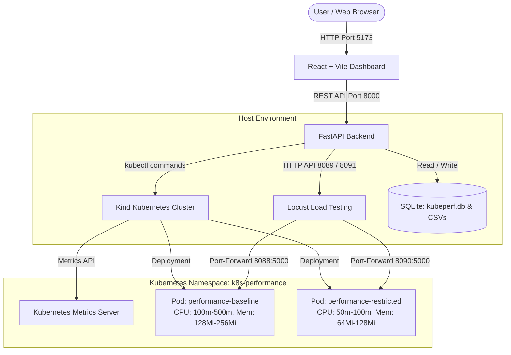

# KubePerf – Kubernetes Performance Analysis Based on Resource Configurations

> An automated performance benchmarking and observability platform that evaluates how Kubernetes CPU and memory resource configurations affect application latency, throughput, and stability under load.

[](https://react.dev/)
[](https://fastapi.tiangolo.com/)
[](https://kind.sigs.k8s.io/)
[](https://locust.io/)
[](LICENSE)

---

## Table of Contents

- [Overview](#overview)
- [Objectives](#objectives)
- [Technologies Used](#technologies-used)
- [System Architecture](#system-architecture)

- [Prerequisites](#prerequisites)
- [Installation and Setup (Windows CMD)](#installation-and-setup-windows-cmd)
- [Dashboard Features](#dashboard-features)
- [Experiment Methodology](#experiment-methodology)
- [Experimental Results](#experimental-results)
- [Result Visualizations](#result-visualizations)
- [Step-by-Step Experiment Guide](#step-by-step-experiment-guide)
- [Troubleshooting](#troubleshooting)
- [Limitations & Future Work](#limitations--future-work)
- [Conclusion](#conclusion)
- [Repository Structure](#repository-structure)

---

## Overview

In containerized cloud environments, configuring proper Kubernetes **CPU requests/limits** and **memory requests/limits** is critical. Inadequate resource limits can trigger severe Completely Fair Scheduler (CFS) CPU throttling, leading to multi-second latency spikes. Conversely, restrictive memory limits result in kernel termination (`OOMKilled`, exit code 137). Over-provisioning leads to low cluster utilization and high cloud infrastructure costs.

**KubePerf** solves this challenge by providing an interactive pairing between:
1. A **target compute service** deployed with configurable resource profiles on a local Kubernetes cluster (Kind).
2. A distributed **Locust load generator** simulating concurrent user traffic.
3. A **FastAPI orchestrator** interacting with the Kubernetes control plane and SQLite database.
4. A **React 18 dashboard** visualizing real-time pod telemetry, latency percentiles, and comparative charts.

---

## Objectives

- **Profile Isolation**: Deploy target web services with Baseline, Restricted, and Out-Of-Memory (OOM) resource profiles.
- **Controlled Load Simulation**: Subject profiles to identical user concurrency and spawn rates using Locust.
- **Empirical Measurement**: Measure mean response times, median ($p50$), 95th percentile ($p95$), throughput (requests/sec), and HTTP failure rates.
- **Live Telemetry**: Stream real CPU (millicores) and memory (MiB) utilization directly from Kubernetes Metrics Server.
- **Scientific Validation**: Detect parameter discrepancies and enforce fair, controlled experiment comparisons.

---

## Technologies Used

| Technology | Role & Purpose |
|---|---|
| **React 18 + Vite** | High-performance SPA frontend with real-time charting and controls. |
| **FastAPI (Python)** | Asynchronous REST backend interfacing with `kubectl`, Locust, and SQLite. |
| **SQLite3** | Embedded zero-configuration persistence for experiment runs and metric samples. |
| **Docker** | Containerization of the target Flask application (`k8s-performance:v1`). |
| **Kind (Kubernetes in Docker)** | Lightweight local Kubernetes multi-node/single-node cluster engine. |
| **Kubernetes Metrics Server** | Native cluster metrics pipeline providing pod CPU and memory utilization. |
| **Locust** | Python-based load testing framework generating synthetic HTTP traffic. |
| **Recharts** | Declarative charting library rendering latency and throughput bar charts. |
| **Lucide Icons** | Clean icon system for the modern dashboard interface. |

---


---

## System Architecture




---


## Prerequisites

Before starting, ensure the following software is installed on your Windows machine:

1. **Docker Desktop**: Running with WSL2 or Hyper-V backend.
2. **Kind**: `kind` CLI installed (`winget install Kubernetes.kind` or via binary).
3. **kubectl**: Kubernetes CLI tool (`winget install Kubernetes.kubectl`).
4. **Python 3.10+**: With `pip` enabled.
5. **Node.js 18+ and npm**: For compiling the React application.

---

## Installation and Setup (Windows CMD)

Follow these exact commands to run KubePerf from scratch.

### Step 1: Clone Repository & Open Directory
```cmd
git clone https://github.com/01fe24bci119/Performance-analysis-of-Kubernetes-resource-configurations.git KubePerf
cd KubePerf
```

### Step 2: Build the Target Application Image
```cmd
docker build -t k8s-performance:v1 ./app
```

### Step 3: Create Kind Cluster & Load Docker Image
```cmd
kind create cluster --name kubeperf
kind load docker-image k8s-performance:v1 --name kubeperf
```

### Step 4: Install Kubernetes Metrics Server
```cmd
kubectl apply -f https://github.com/kubernetes-sigs/metrics-server/releases/latest/download/components.yaml
kubectl patch deployment metrics-server -n kube-system --type="json" -p="[{\"op\":\"add\",\"path\":\"/spec/template/spec/containers/0/args/-\",\"value\":\"--kubelet-insecure-tls\"}]"
```

### Step 5: Deploy Kubernetes Manifests
```cmd
kubectl apply -f k8s/namespace.yaml
kubectl apply -f k8s/deployment-baseline.yaml
kubectl apply -f k8s/deployment-restricted.yaml
kubectl apply -f k8s/service.yaml
```

Verify pods are running:
```cmd
kubectl get pods -n k8s-performance
```

---

### Step 6: Start Application Port-Forwards (Separate CMD Windows)

Open **two separate CMD windows** to keep pod services accessible:

- **Window A (Baseline Service Port-Forward)**:
  ```cmd
  kubectl port-forward svc/performance-baseline 8088:5000 -n k8s-performance
  ```

- **Window B (Restricted Service Port-Forward)**:
  ```cmd
  kubectl port-forward svc/performance-restricted 8090:5000 -n k8s-performance
  ```

---

### Step 7: Start Locust Load Generators (Separate CMD Windows)

Open **two separate CMD windows** to run the Locust instances:

- **Window C (Baseline Locust Generator - Port 8089)**:
  ```cmd
  cd KubePerf
  locust -f locustfile.py --web-port 8089 -H http://localhost:8088
  ```

- **Window D (Restricted Locust Generator - Port 8091)**:
  ```cmd
  cd KubePerf
  locust -f locustfile.py --web-port 8091 -H http://localhost:8090
  ```

---

### Step 8: Start Backend Server (CMD Window E)

```cmd
cd KubePerf\backend
python -m venv venv
venv\Scripts\activate
pip install -r requirements.txt
uvicorn main:app --reload --port 8000
```

---

### Step 9: Start Frontend Dashboard (CMD Window F)

```cmd
cd KubePerf
copy .env.example .env
npm install
npm run dev
```

Open your browser and navigate to: **`http://localhost:5173`**

---

## Dashboard Features

The KubePerf user interface consists of 5 dedicated sections:

1. **Overview**:
   - Live status cards displaying the latest Baseline and Restricted average response latencies and throughputs.
   - Dynamic bar chart comparing latency between profiles.
   - System integration indicator reporting health of FastAPI and Metrics Server.

2. **Configurations**:
   - Detailed inspection cards for Baseline (`100m/500m` CPU), Restricted (`50m/100m` CPU), and OOM demo profiles.
   - One-click **Deploy Configuration** button that triggers rolling updates on the cluster via `kubectl set resources`.

3. **Experiments**:
   - Interactive workload controls: set virtual **Number of Users** (1–500) and **Spawn Rate** (0.1–100/s).
   - **Start experiment** and **Stop & save** buttons with live synchronization against backend state.
   - Live stat counters refreshing every 2 seconds during active tests.
   - Historical experiment runs table.

4. **Live Monitoring**:
   - Live cluster statistics: Total CPU usage (millicores), total RAM (MiB), running pods, and container restart counters.
   - Time-series line charts tracking Baseline vs Restricted pod CPU and memory consumption over time.
   - Real-time Kubernetes pod status table.

5. **Results & Analysis**:
   - Side-by-side comparative analysis of the latest completed experiments.
   - **Controlled Experiment Validator**: Alerts if workloads differ or confirms controlled parity.
   - Average response latency and throughput bar charts.
   - Searchable detailed experiment history with full CSV export references.

---

## Experiment Methodology

### Resource Profiles

| Profile | CPU Request | CPU Limit | Memory Request | Memory Limit | Intended Stress Effect |
|---|---|---|---|---|---|
| **Baseline** | `100m` | `500m` | `128Mi` | `256Mi` | Ample headroom; uninhibited compute under moderate loads. |
| **Restricted** | `50m` | `100m` | `64Mi` | `128Mi` | Heavy CFS CPU quota throttling; queues concurrent compute requests. |
| **OOM Demo** | `50m` | `100m` | `10Mi` | `15Mi` | Demonstrates out-of-memory crash loop (`OOMKilled`, exit code 137). |

### Workload Parity Rules
To achieve scientifically sound conclusions, comparisons between configurations must ensure:
- **Same User Count**: Identical number of concurrent virtual users (e.g., 2 users).
- **Same Spawn Rate**: Identical user ramp rate (e.g., 1 user/sec).
- **Equal Test Duration**: Identical test runtime (e.g., 120 seconds).

---

## Experimental Results

The following table contains actual benchmark data recorded in SQLite (`backend/kubeperf.db`) and verified against the CSV files in `results/`:

| ID | Configuration | Users | Spawn Rate | Requests | Avg Response | Median | p95 | Throughput | Failures | Evaluation Note |
|---|---|---:|---:|---:|---:|---:|---:|---:|---:|---|
| **1** | Baseline | 2 | 1.0/s | 498 | **139.57 ms** | 150.0 ms | 300.0 ms | 1.10 req/s | 0 | Controlled 2-user baseline |
| **2** | Restricted | 2 | 1.0/s | 96 | **1101.55 ms** | 1100.0 ms | 2900.0 ms | 1.00 req/s | 0 | Controlled 2-user restricted ($~8\times$ slower) |
| **3** | Baseline | 2 | 1.0/s | 619 | **148.57 ms** | 160.0 ms | 340.0 ms | 1.30 req/s | 0 | Sustained baseline stability run |
| **4** | Baseline | 20 | 2.0/s | 28 | **248.19 ms** | 97.0 ms | 790.0 ms | 3.67 req/s | 0 | High concurrency stress test |
| **5** | Baseline | 2 | 1.0/s | 48 | **109.99 ms** | 83.0 ms | 240.0 ms | 0.90 req/s | 0 | Short validation test |
| **6** | Restricted | 2 | 1.0/s | 422 | **1320.36 ms** | 1900.0 ms | 2100.0 ms | 0.60 req/s | 208 | Pod reconnection timeout during run |

### Key Observations
1. **Severe Latency Degradation**: Under the exact same 2-user load, the Restricted deployment experienced average latencies of **$1101.55\text{ ms}$ – $1320.36\text{ ms}$**, compared to **$109.99\text{ ms}$ – $148.57\text{ ms}$** on the Baseline deployment. This represents an approximate **$8\times$ to $9\times$ latency penalty** caused by CPU CFS quota throttling.
2. **Tail Latency Sensitivity**: 95th percentile ($p95$) latency reached **$2100\text{ ms} - 2900\text{ ms}$** under restricted resources versus **$240\text{ ms} - 340\text{ ms}$** in baseline.

---

## Result Visualizations

All graphs are generated directly from the verified database records:

### 1. Response Time Comparison


### 2. Throughput Comparison


### 3. CPU Telemetry (Kubernetes Metrics Server)


### 4. Memory Telemetry (Kubernetes Metrics Server)


---

## Step-by-Step Experiment Guide

1. **Deploy Target Configuration**: Navigate to the **Configurations** tab, select **Baseline** or **Restricted**, and click **Deploy Configuration**.
2. **Configure Workload**: Go to the **Experiments** tab. Enter **2 Users** and **Spawn Rate = 1**.
3. **Execute Test**: Click **Start experiment**. The live statistics cards will begin streaming requests, average response latency, and throughput every 2 seconds.
4. **Finalize Run**: After your desired test duration (e.g., 120 seconds), click **Stop & save**. The experiment row will instantly be added to the history table and saved as a CSV in `results/`.
5. **Analyze Results**: Switch to the **Results & analysis** tab to view the side-by-side comparison, charts, and controlled experiment verification badge.

---

## Troubleshooting

| Issue | Cause | Solution |
|---|---|---|
| **Docker Desktop not running** | Docker engine is stopped. | Launch Docker Desktop from the Start menu and wait until the whale icon shows "Engine running". |
| **Kind cluster not found** | Cluster not created. | Execute `kind create cluster --name kubeperf` and reload image with `kind load docker-image k8s-performance:v1 --name kubeperf`. |
| **ImagePullBackOff** | Pod cannot pull image from public registry. | Ensure local image is loaded into Kind: `kind load docker-image k8s-performance:v1 --name kubeperf`. Verify manifest contains `imagePullPolicy: IfNotPresent`. |
| **Port-forward connection errors** | Pod restarted or port-forward closed. | Restart the `kubectl port-forward` commands in their respective CMD windows. |
| **FastAPI connection errors** | Backend server not running on port 8000. | Check CMD Window E: verify `uvicorn main:app --reload --port 8000` is active without Python tracebacks. |
| **Locust connection failures** | Target port-forward is inactive. | Ensure `kubectl port-forward` on 8088 and 8090 are running before starting Locust on 8089 and 8091. |
| **Metrics Server unavailable** | Metrics Server needs insecure TLS on local Kind. | Run: `kubectl patch deployment metrics-server -n kube-system --type="json" -p="[{\"op\":\"add\",\"path\":\"/spec/template/spec/containers/0/args/-\",\"value\":\"--kubelet-insecure-tls\"}]"` |
| **Experiment stuck in running state** | Previous run not cleanly closed. | Use the "Stop & save" button in the dashboard, or call: `curl -X POST http://localhost:8000/api/experiments/stop/baseline` (or `restricted`). |

---

## Limitations & Future Work

- **Host Resource Contention**: Running Kind, Docker, Locust, and the browser simultaneously on one Windows machine can introduce minor scheduling noise compared to dedicated multi-node cloud clusters.
- **Metrics Resolution**: Standard Kubernetes Metrics Server provides point-in-time metrics every 15–60 seconds. Future iterations could integrate Prometheus and cAdvisor for sub-second CFS quota throttling telemetry (`container_cpu_cfs_throttled_periods_total`).
- **Autoscaling (HPA)**: Adding Horizontal Pod Autoscaler evaluation based on CPU thresholds would extend KubePerf to evaluate scaling elasticity.

---

## Conclusion

**KubePerf** demonstrates that Kubernetes resource limits have an immediate, profound impact on web application performance. Capping container CPU limits to `100m` without adjusting compute workloads resulted in an $8\times$ latency penalty and severe tail latency degradation. Through real-time telemetry, automated experiment workflows, and reproducible CSV exports, KubePerf provides an essential educational and practical benchmark for cloud-native performance engineering.

---
## Repository Structure

```
KubePerf/
├── app/                              # Target compute-intensive microservice
│   ├── app.py                        # Flask service with /, /work, and /health endpoints
│   ├── Dockerfile                    # Container definition for k8s-performance:v1
│   └── requirements.txt              # Flask dependencies
├── backend/                          # FastAPI REST API & cluster orchestrator
│   ├── main.py                       # FastAPI application and kubectl integration
│   ├── kubeperf.db                   # SQLite database (metric samples & experiments)
│   └── requirements.txt              # FastAPI & Uvicorn dependencies
├── k8s/                              # Kubernetes manifests
│   ├── namespace.yaml                # Creates 'k8s-performance' namespace
│   ├── deployment-baseline.yaml      # Baseline profile (100m/500m CPU, 128Mi/256Mi RAM)
│   ├── deployment-restricted.yaml    # Restricted profile (50m/100m CPU, 64Mi/128Mi RAM)
│   ├── deployment-oom.yaml           # OOM demonstration deployment (10Mi/15Mi RAM)
│   └── service.yaml                  # ClusterIP services for Baseline & Restricted pods
├── results/                          # Benchmark results and exported artifacts
│   ├── experiment_1_baseline.csv     # Verified Locust run records
│   ├── experiment_2_restricted.csv
│   ├── experiment_3_baseline.csv
│   ├── experiment_4_baseline.csv
│   ├── experiment_5_baseline.csv
│   ├── experiment_6_restricted.csv
│   ├── response_time_comparison.png  # Generated analysis charts
│   ├── throughput_comparison.png
│   ├── cpu_usage_monitoring.png
│   ├── memory_usage_monitoring.png
│   └── generate_graphs.py            # Graph generation script
├── docs/                             # In-depth architectural & empirical documentation
│   ├── ARCHITECTURE.md               # Component communication & data flow details
│   ├── EXPERIMENT_METHODOLOGY.md     # Controlled benchmark principles & guidelines
│   └── RESULTS.md                    # Data analysis & failure investigation report
├── src/                              # React dashboard source code
│   ├── App.jsx                       # Main application shell and route components
│   ├── main.jsx                      # React DOM mounting
│   ├── styles.css                    # Unified modern dashboard stylesheet
│   └── services/api.js               # Reusable API fetch wrappers
├── locustfile.py                     # Locust load test task definitions
├── package.json                      # Frontend NPM dependencies & build scripts
├── vite.config.js                    # Vite configuration
├── .env.example                      # Environment variable template
├── .gitignore                        # Git exclusion rules
└── README.md                         # Project documentation
```

---
